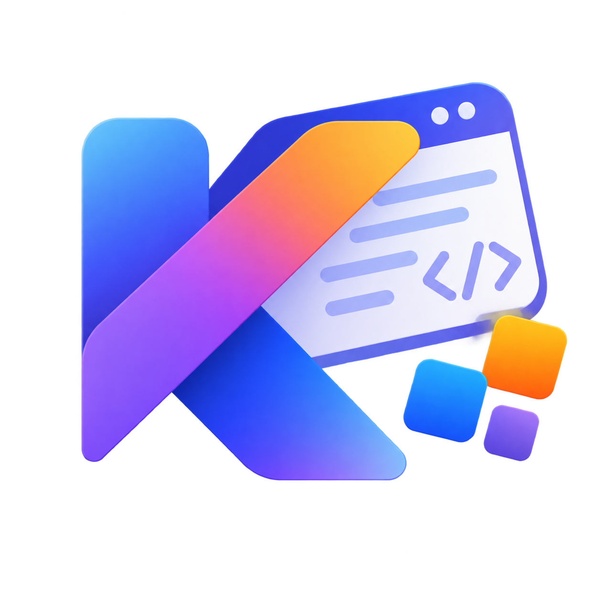

# ktjs-dockview

<p align="center"></p>

A Kotlin/JS wrapper for [`dockview`](https://www.npmjs.com/package/dockview): the dock layout engine
with tabs, groups, split views and drag-and-drop, declared from upstream's own `.d.ts` files.

[English](README.md) | [简体中文](README.zh-CN.md)

**[Documentation](https://shijianjs.github.io/ktjs-dockview/)** ·
**[Live demo](https://shijianjs.github.io/ktjs-dockview/demo/)** ·
**[API reference](https://shijianjs.github.io/ktjs-dockview/api/)**

```kotlin
val api = createDockview(host, dockviewComponentOptions(::renderer) { theme = themeDark })

api.addPanel(addPanelOptions { id = "alpha"; component = "text"; title = "Alpha" })
api.maximizeGroup(api.getPanel("alpha")!!)
```

## Modules

| Module | npm package | Wrapper version |
| --- | --- | --- |
| [ktjs-dockview](ktjs-dockview/README.md) | `dockview` | `8.9.1-kt.1` |

## What the wrapper maps

| Upstream | Kotlin |
| --- | --- |
| `createDockview` / `-Splitview` / `-Gridview` / `-Paneview` | four `external fun`s, each returning its API |
| `DockviewApi`, `SplitviewApi`, `GridviewApi`, `PaneviewApi` | the same classes, every member declared |
| `DockviewOptions & DockviewFrameworkOptions` | `DockviewComponentOptions` + the `dockviewComponentOptions` builder |
| `IContentRenderer`, `GroupPanelPartInitParameters` | the same interfaces — a Kotlin class can implement them |
| `Event<T>` (a callable object) | `DockviewEventSource<T>` (a function type) + the `listen` extension |
| 18 theme values | `themeDark`, `themeLight`, … as `DockviewTheme` |
| `SerializedDockview` | an opaque interface, passed back to `fromJSON` |

Unlike the other wrappers in this family, upstream ships full `.d.ts` files, so every declaration is
read from them rather than inferred from source. `dockview-enterprise` is **commercial software** and
is deliberately not wrapped; see [docs/development/coverage.md](docs/development/coverage.md) for the
exact exclusion list and the licences.

## Versioning

Each module is versioned as `{upstream npm version}-kt.{revision}`. The upstream npm versions are
declared once in the root [`package.json`](package.json); the revision is read per module from
[`wrapper-revisions.properties`](wrapper-revisions.properties).

- Only `-kt.N` versions are published; a version without the suffix never exists.
- A working tree always adds `-SNAPSHOT`: the derived number is the *next* release. Publishing passes
  `-Pktjs.release=true`, which drops the suffix.
- Upstream upgrade: change the version in `package.json`; the base version follows automatically.
- Wrapper-only fix: the revision increments (`kt.2`, `kt.3`, ...) while the base version stays.

## Requirements

- JDK 21 or newer (the build uses Gradle 9.4.1).
- Node and npm are downloaded automatically by the Kotlin Gradle plugin; `kotlin.js.yarn=false` in
  `gradle.properties` keeps npm as the package manager.
- Chromium is downloaded by Playwright the first time browser tests run.

## Build and test

```bash
./gradlew build                    # compile, Detekt, browser tests
./gradlew :ktjs-dockview:jsBrowserTest

# End-to-end checks for the demo page (Playwright, against the bundled output)
./gradlew :demo:e2eTest

# Documentation site: Kotlin configuration, Markdown pages, built by ktjs-docusaurus
./gradlew :docs:docusaurusBuild

# GitHub Pages site (documentation at the root, demo under /demo/, Dokka output under /api/)
./gradlew pagesSite
```

After adding or upgrading an npm dependency, refresh the shared lock file:

```bash
./gradlew kotlinUpgradePackageLock
```

## License

Released under the [MIT License](LICENSE). Upstream `dockview` is MIT too, © dockview contributors;
the enterprise package is proprietary and is not part of this wrapper — see
[Licensing](https://shijianjs.github.io/ktjs-dockview/guide/licensing).
