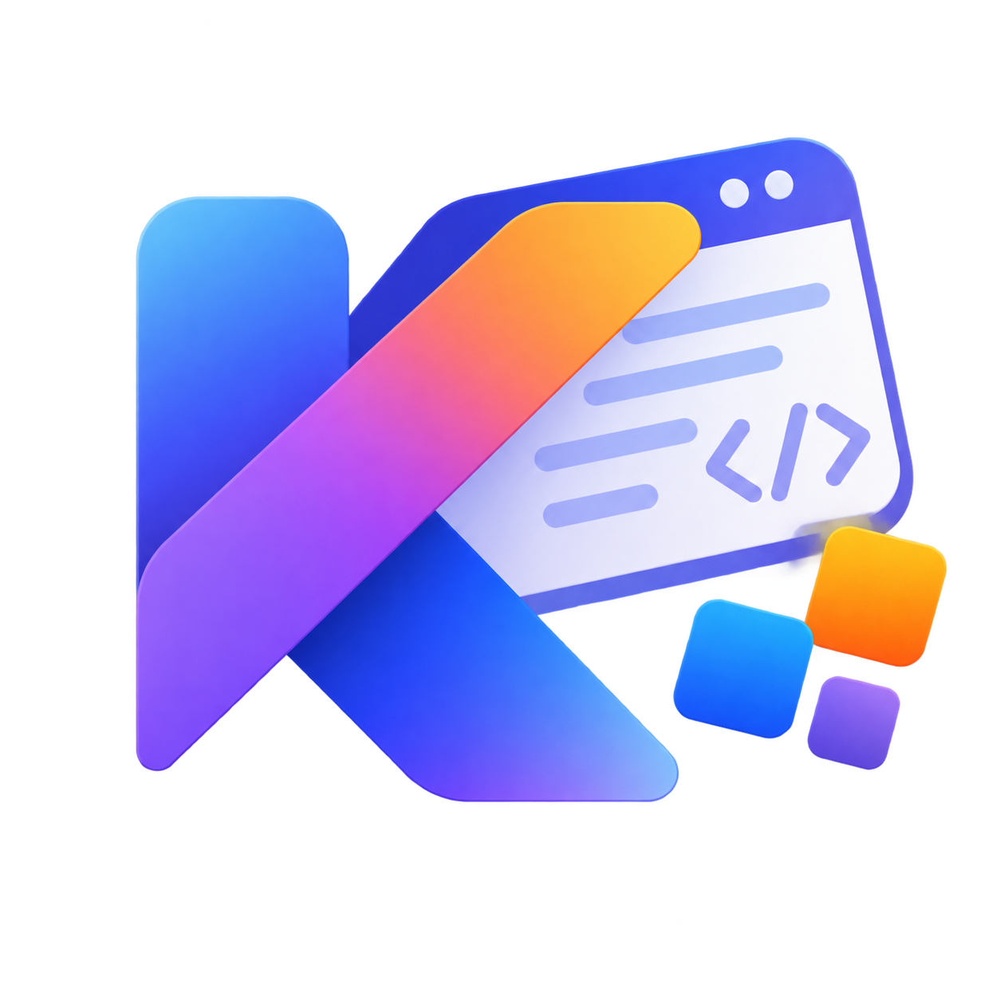

# ktjs-dockview

<p align="center"></p>

[`dockview`](https://www.npmjs.com/package/dockview) 的 Kotlin/JS 封装：带标签页、分组、分栏与拖拽的
停靠布局引擎，按上游自带的 `.d.ts` 声明。

[English](README.md) | [简体中文](README.zh-CN.md)

**[文档](https://shijianjs.github.io/ktjs-dockview/)** ·
**[在线演示](https://shijianjs.github.io/ktjs-dockview/demo/)** ·
**[API 文档](https://shijianjs.github.io/ktjs-dockview/api/)**

```kotlin
val api = createDockview(host, dockviewComponentOptions(::renderer) { theme = themeDark })

api.addPanel(addPanelOptions { id = "alpha"; component = "text"; title = "Alpha" })
api.maximizeGroup(api.getPanel("alpha")!!)
```

## 模块

| 模块 | npm 包 | wrapper 版本 |
| --- | --- | --- |
| [ktjs-dockview](ktjs-dockview/README.zh-CN.md) | `dockview` | `8.9.1-kt.1` |

## 封装了什么

| 上游 | Kotlin |
| --- | --- |
| `createDockview` / `-Splitview` / `-Gridview` / `-Paneview` | 四个 `external fun`，各自返回自己的 API |
| `DockviewApi`、`SplitviewApi`、`GridviewApi`、`PaneviewApi` | 同名类，成员逐个声明 |
| `DockviewOptions & DockviewFrameworkOptions` | `DockviewComponentOptions` + `dockviewComponentOptions` 构造器 |
| `IContentRenderer`、`GroupPanelPartInitParameters` | 同名接口——Kotlin 类可以直接实现 |
| `Event<T>`（可调用对象） | `DockviewEventSource<T>`（函数类型）+ `listen` 扩展 |
| 18 个主题值 | `themeDark`、`themeLight` 等，类型是 `DockviewTheme` |
| `SerializedDockview` | 不透明接口，原样交回 `fromJSON` |

与这一族其他封装不同，上游自带完整的 `.d.ts`，所以每个声明都照它写，而不是从源码猜。
`dockview-enterprise` 是**商业软件**，刻意不封装；排除清单与许可见
[docs/development/coverage.md](docs/development/coverage.md)。

## 版本约定

每个模块的版本是 `{上游 npm 版本}-kt.{修订号}`。上游 npm 版本只在根
[`package.json`](package.json) 里声明；修订号按模块记在
[`wrapper-revisions.properties`](wrapper-revisions.properties)。

- 只发布 `-kt.N` 版本；不带后缀的版本号从来不存在。
- 工作树总加 `-SNAPSHOT`：推出的号是*下一个*发布版本。发布时传 `-Pktjs.release=true` 去掉后缀。
- 升级上游：改 `package.json` 里的版本，base 版本自动跟随。
- 只修封装：修订号递增（`kt.2`、`kt.3`……），base 版本不动。

## 环境要求

- JDK 21 或更新（构建用 Gradle 9.4.1）。
- Node 与 npm 由 Kotlin Gradle 插件自动下载；`gradle.properties` 里 `kotlin.js.yarn=false` 保持用 npm。
- 首次跑浏览器测试时，Playwright 会下载 Chromium。

## 构建与测试

```bash
./gradlew build                    # 编译、Detekt、浏览器测试
./gradlew :ktjs-dockview:jsBrowserTest

# demo 页的端到端检查（Playwright，打的是打包后的产物）
./gradlew :demo:e2eTest

# 文档站：Kotlin 配置、Markdown 页面，由 ktjs-docusaurus 构建
./gradlew :docs:docusaurusBuild

# GitHub Pages 站点（根目录是文档，/demo/ 是演示，/api/ 是 Dokka 输出）
./gradlew pagesSite
```

新增或升级 npm 依赖后，刷新共享锁文件：

```bash
./gradlew kotlinUpgradePackageLock
```

## 许可证

以 [MIT License](LICENSE) 发布。上游 `dockview` 同为 MIT，版权归 dockview contributors；
enterprise 包是专有许可，不属于本封装——见
[许可证](https://shijianjs.github.io/ktjs-dockview/zh-Hans/guide/licensing)。
