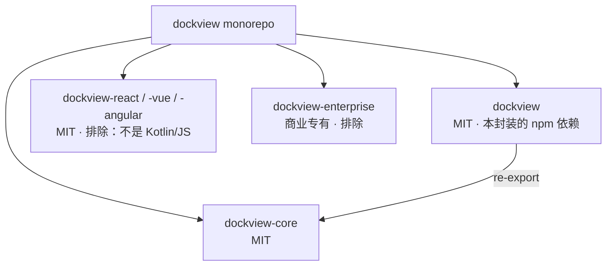

# API coverage

## 来源与范围

- 上游：[dockview/dockview](https://github.com/dockview/dockview)，本地副本 `S:\workspace\github\dockview\dockview`
- 版本：`dockview` 8.9.1（根 `package.json`），类型在 npm 包的 `dist/cjs/index.d.ts` 及子目录
- 声明依据：上游自带的 `.d.ts`（不是源码推断）；`dockview` 直接 `export * from "dockview-core"`，
  两份声明一致，取 `dockview` 作为唯一的 npm 依赖
- 核对日期：2026-11-22
- 纳入统计：`dockview` 包的四个工厂、组件类、四个 API 类、面板/分组 API、18 个主题、选项与事件形状、
  渲染器契约、构造器函数
- 不纳入：框架绑定包（`dockview-react` / `-vue` / `-angular`）、商业包 `dockview-enterprise`、
  `modules` 注册系统、popout 窗口与 dnd 助手导出、站点与示例源码

## 统计

- 总计：70
- 已完成：66
- 明确不做：4
- 待完成：0

## 已完成

| # | 上游声明 | Kotlin | 测试 |
| --- | --- | --- | --- |
| 1 | `createDockview(el, options)` | `createDockview` | `createDockviewReturnsAnEmptyApi` |
| 2 | `createSplitview` | `createSplitview` | 编译期覆盖（未运行，见备注） |
| 3 | `createGridview` | `createGridview` | 同上 |
| 4 | `createPaneview` | `createPaneview` | 同上 |
| 5–22 | 18 个主题值 | `themeDark` … `themeGithubLightSpaced` | `themesAreObjectsWithAClassName` |
| 23 | `DockviewComponent` | `DockviewComponent` | 经 `createDockview` 间接覆盖 |
| 24 | `DockviewApi` | `DockviewApi` | `addPanel` / `panelsAreLookedUpByIdAndRemoved` / `aGroupCanBeAddedNextToAnother` / `theLayoutRoundTripsThroughJSON` |
| 25 | `DockviewPanel` | `DockviewPanel` | 同上 |
| 26 | `DockviewGroupPanel` | `DockviewGroupPanel` | `aGroupCanBeAddedNextToAnother` |
| 27 | `DockviewPanelApi` | `DockviewPanelApi` | `panelTitlesCanBeRewrittenThroughThePanelApi` |
| 28 | `DockviewGroupPanelApi` | `DockviewGroupPanelApi` | 类型覆盖 |
| 29 | `SplitviewApi` | `SplitviewApi` | 类型覆盖 |
| 30 | `SplitviewPanel` | `SplitviewPanel` | 类型覆盖 |
| 31 | `GridviewApi` | `GridviewApi` | 类型覆盖 |
| 32 | `GridviewPanel` | `GridviewPanel` | 类型覆盖 |
| 33 | `PaneviewApi` | `PaneviewApi` | 类型覆盖 |
| 34 | `PaneviewPanel` | `PaneviewPanel` | 类型覆盖 |
| 35 | `PanelApi` | `PanelApi` | 类型覆盖 |
| 36 | `Event<T>` + 订阅/退订 | `DockviewEventSource<T>` + `listen` | `aSubscriptionIsDisposable` |
| 37 | `IDisposable` | `DockviewIDisposable` | 同上 |
| 38 | `LayoutChangeEvent` | `LayoutChangeEvent` | 经事件回调覆盖 |
| 39 | `TitleEvent` | `TitleEvent` | `panelTitlesCanBeRewrittenThroughThePanelApi` |
| 40 | `DockviewTheme` | `DockviewTheme` | `themesAreObjectsWithAClassName` |
| 41 | `DockviewOptions` | `DockviewOptions`（23 字段） | `createDockview` 传 `theme` |
| 42 | `CreateComponentOptions` | `CreateComponentOptions` | 渲染器工厂 |
| 43 | `GroupPanelPartInitParameters` | `GroupPanelPartInitParameters` | `theRendererReceivesTheTitle` |
| 44 | `IContentRenderer` | `IContentRenderer` | `theRendererReceivesTheTitle` |
| 45 | `IPanePart` | `IPanePart` | 类型覆盖 |
| 46 | `DockviewComponentOptions` | `DockviewComponentOptions` | `createDockview` |
| 47 | `AddPanelOptions` | `AddPanelOptions` | `addPanelCreatesAPanelAndATab` |
| 48 | `AddGroupOptions` | `AddGroupOptions` | `aGroupCanBeAddedNextToAnother` |
| 49 | `SerializedDockview` | 不透明 `external interface` | `theLayoutRoundTripsThroughJSON` |
| 50 | `SerializedSplitview` | 不透明 `external interface` | 类型覆盖 |
| 51 | `SplitviewOptions` | `SplitviewOptions` | 类型覆盖 |
| 52 | `SplitviewComponentOptions` | `SplitviewComponentOptions` | 类型覆盖 |
| 53 | `AddSplitviewComponentOptions` | `AddSplitviewComponentOptions` | 类型覆盖 |
| 54 | `GridviewOptions` | `GridviewOptions` | 类型覆盖 |
| 55 | `GridviewComponentOptions` | `GridviewComponentOptions` | 类型覆盖 |
| 56 | `AddGridviewComponentOptions` | `AddGridviewComponentOptions` | 类型覆盖 |
| 57 | `PaneviewOptions` | `PaneviewOptions` | 类型覆盖 |
| 58 | `PaneviewComponentOptions` | `PaneviewComponentOptions` | 类型覆盖 |
| 59 | `AddPaneviewComponentOptions` | `AddPaneviewComponentOptions` | 类型覆盖 |
| 60 | `dockviewOptions { }` | 同名构造器 | `createDockview` |
| 61 | `dockviewComponentOptions { }` | 同名构造器 | `createDockview` |
| 62 | `addPanelOptions { }` | 同名构造器 | `addPanelCreatesAPanelAndATab` |
| 63 | `addGroupOptions { }` | 同名构造器 | `aGroupCanBeAddedNextToAnother` |
| 64 | `splitviewComponentOptions` | 同名构造器 | 类型覆盖 |
| 65 | `gridviewComponentOptions` | 同名构造器 | 类型覆盖 |
| 66 | `paneviewComponentOptions` | 同名构造器 | 类型覆盖 |

备注：2–4、29–35、45、50–58、64–66 的「类型覆盖」指声明在模块里、由浏览器测试的编译期检查保证可用；
它们的运行时行为与 `createDockview` 同源（同一份核心引擎），本模块没有为它们单独写浏览器用例。

## 明确不做

| # | 上游 | 理由 |
| --- | --- | --- |
| 67 | `dockview-enterprise` | **商业专有许可**（`packages/dockview-enterprise/LICENCE.md`），不能再分发；只做开源免费部分 |
| 68 | `dockview-react` / `dockview-vue` / `dockview-angular` | 框架绑定包；Kotlin/JS 消费方用的是 `dockview` 的原生 API，多包一层是重复 |
| 69 | `modules` 系统（`registerModules` 及 `DockviewOptions.modules`） | 额外功能的插件注册表，属于上游扩展机制；先不纳入，需要时再单独评估 |
| 70 | popout 窗口与 dnd 助手导出（`addPopoutGroup`、`dnd/dataTransfer`） | 依赖 window / 跨文档环境，demo 与测试都不覆盖；保持「只声明可验证的部分」 |

## 部分覆盖

`DockviewOptions` 声明了 23 个字段，上游约 60 个。选择标准是「文档覆盖到的字段」：布局关键开关
（`disableAutoResizing`、`proportionalLayout`、`hideBorders`、`locked`、`disableDnd`、`closeEmptyGroups`）、
主题与类名、`singleTabMode`、`defaultRenderer`、`debug` 等。其余字段大多与 floating group、popout、
overflow 细节相关，等对应能力纳入时一起补，避免声明一堆没有验证途径的字段。

联合类型字段（`dndEdges`、`overflow`、`dndCompass`、`floatingGroupBounds`、`AddPanelOptions.position` /
`params`）保持 `JsAny`：上游给它们各自定义了形状，Kotlin 侧造联合类型只会增加一层需要维护的映射。
`SerializedDockview` / `SerializedSplitview` 故意声明为空 `external interface`：结构随上游小版本变化，
只用于 `toJSON` → `fromJSON` 的往返。

## 许可差异

上游根 `LICENCE.md` 明确「不是所有包共用同一个许可」：`dockview-core`、`dockview`、三个框架绑定包是
MIT，`dockview-enterprise` 是商业专有。本封装只依赖 MIT 的 `dockview`；许可声明见
[`../guide/licensing.md`](../src/jsMain/resources/docs/guide/licensing.md)。
