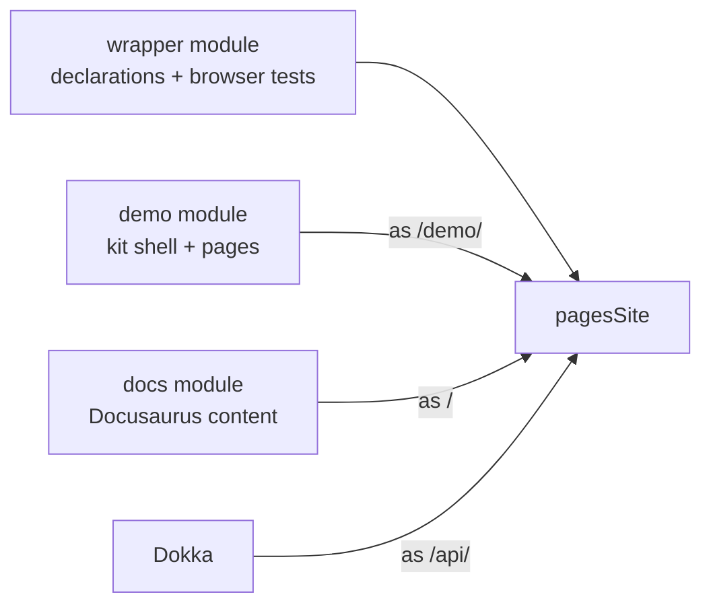

# Getting started

## Requirements

- JDK 21 or newer; the Gradle wrapper is checked in (9.4.1).
- Node and npm are downloaded and driven by the Kotlin Gradle plugin — there is no `npm install` step
  to remember, and `kotlin.js.yarn=false` keeps npm as the package manager.
- Chromium is downloaded by Playwright the first time a browser test runs.

## Build, test, publish

```bash
./gradlew build                    # compile, Detekt, browser tests
./gradlew :ktjs-dockview:jsBrowserTest
./gradlew :demo:e2eTest            # Playwright against the bundled demo page
./gradlew :docs:docusaurusBuild    # the documentation site
./gradlew pagesSite                # documentation at /, demo at /demo/, Dokka at /api/
```

`build` does not run the demo's end-to-end suite or assemble the Pages site: both need a browser and
are part of CI as separate steps.



## Develop

```bash
./gradlew :docs:docusaurusStart              # dev server for this site
./gradlew :demo:jsBrowserDevelopmentRun      # dev server for the demo page
```

Docusaurus watches the site directory, so Markdown edits reload; Kotlin changes need
`./gradlew :docs:docusaurusSite` first, because the site imports the compiled module.

### When the demo dev server fails

`jsBrowserDevelopmentRun` runs webpack as an external process. When that process exits with a
non-zero code, the Kotlin Gradle plugin can only report `Error occurred. See log for details.`:
whatever webpack printed was forwarded as progress lines, and the default console erases the progress
area when the task ends. Rerun with a plain console to keep them:

```bash
./gradlew :demo:jsBrowserDevelopmentRun --console=plain
```

If the plain console stays empty too, run the command Gradle runs and read its stderr directly; the
generated package is under `build/js/packages/<module>-demo`:

```bash
cd build/js/packages/ktjs-dockview-demo
node ../../node_modules/webpack/bin/webpack.js serve --config webpack.config.js
```

For any suspicious startup failure, try a fresh daemon before anything else: `./gradlew --stop`, then
rerun. A long-lived daemon carries stale state from the previous build.

## Depend on the wrapper

```kotlin
kotlin {
    js {
        browser()
        binaries.library()
    }
    sourceSets {
        jsMain.dependencies {
            implementation("io.github.shijianjs:ktjs-dockview:8.9.1-kt.1")
        }
    }
}
```

The published version is `{npm version}-kt.{revision}`, so `8.9.1-kt.1` is `dockview` 8.9.1 with the
first wrapper revision. The npm package itself is declared by the module, so a consumer adds nothing
else to `package.json`.

## The stylesheet is not optional

`dockview` ships its CSS separately, at `dockview/dist/styles/dockview.css`. A page that never loads
it gets a layout with no borders, no tabs and no drag handles — and no error in the console.

```html
<link rel="stylesheet" href="dockview.css">
```

```javascript
import "dockview/dist/styles/dockview.css"; // a bundler that understands CSS imports
```

:::warning Inside a shadow root
Document stylesheets do not cross a shadow boundary. If your page draws the dock inside its own shadow
tree (this demo does), copy the sheet's rules into an adopted stylesheet — the demo's
`DemoPage.addLinkedSheet("dockview.css")` does that, and re-points `:root` at `:host` so the theme's
CSS variables still resolve.
:::

## The first dock

The host has to have a height before the dock is created: upstream measures its container, and a zero
height gives every group a zero size.

```kotlin
val host = document.createElement(HtmlTagName.div).also { element ->
    element.style.width = "100%"
    element.style.height = "420px"
    document.body.append(element)
}

val api = createDockview(
    host,
    dockviewComponentOptions(createComponent = { options ->
        // One renderer per panel; `options.name` is the component name the options registered.
        PanelRenderer(document.createElement(HtmlTagName.div))
    }) {
        theme = themeDark
    },
)

api.addPanel(addPanelOptions { id = "alpha"; component = "text"; title = "Alpha" })
```

`component` in `addPanelOptions` names the renderer: every panel that passes the same name gets a new
object from the factory. The factory is where a page keeps its own state — the demo pushes every
renderer into a list so a language switch can rewrite their copy.

## Where things live

| Path | Contents |
| --- | --- |
| `package.json` | the only place npm versions are declared (Dependabot maintains it) |
| `wrapper-revisions.properties` | per-module `-kt.N` revision |
| `ktjs-dockview/src/jsMain/kotlin` | the wrapper declarations |
| `ktjs-dockview/src/jsTest/kotlin` | browser tests for them |
| `demo/src/jsMain` | the demo page, its pages and its Kotlin entry point |
| `docs/src/jsMain/kotlin` | the site configuration and sidebar |
| `docs/src/jsMain/resources` | Markdown pages, MDX landing page, CSS, translations |
| `docs/development/coverage.md` | what is wrapped, what is excluded and why |

## The lock file

npm dependencies are resolved once for the whole workspace and pinned in
`kotlin-js-store/package-lock.json`. After adding or upgrading an npm dependency — or changing a
module's version — regenerate it:

```bash
./gradlew kotlinUpgradePackageLock
```

CI verifies the committed file, so a forgotten regeneration fails the build rather than drifting.
