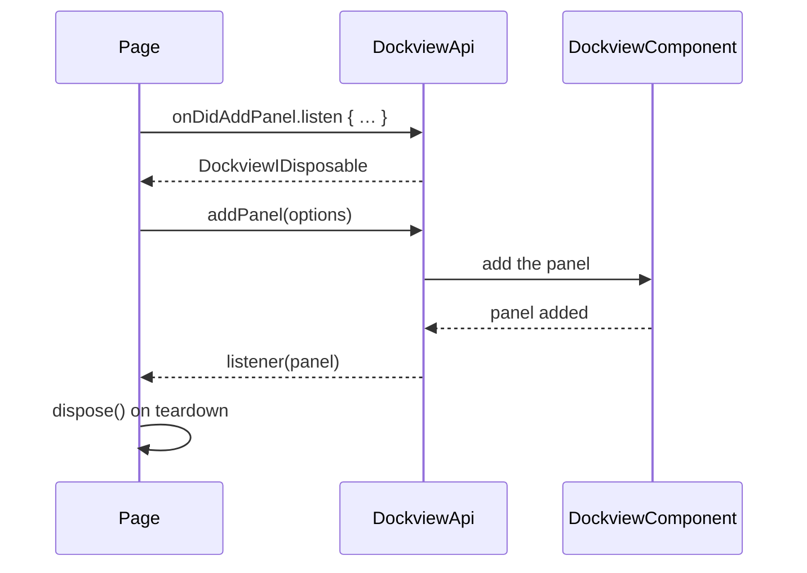
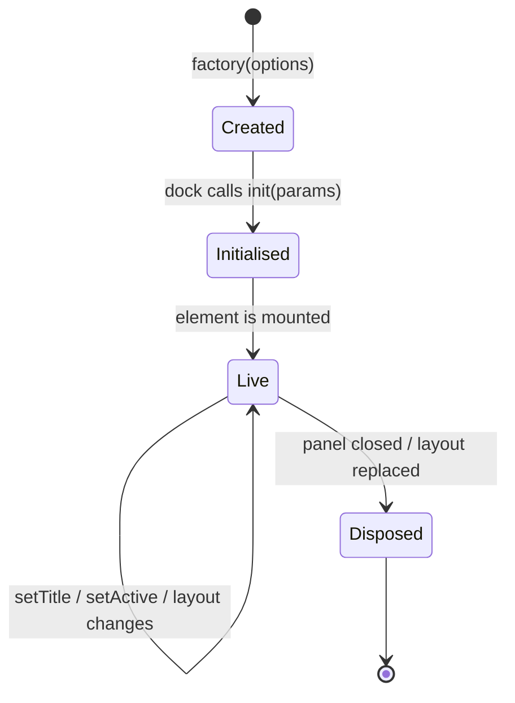
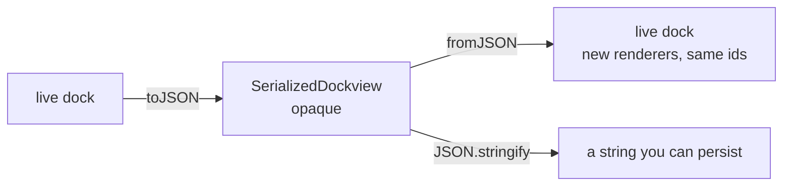

# Usage

## Panels

A panel is one tab plus its content. `addPanel` returns the panel object, and the same options object
works on both `DockviewApi` and `DockviewComponent`:

```kotlin
val panel = api.addPanel(
    addPanelOptions {
        id = "logs"            // required: the id every later lookup uses
        component = "text"     // required: the renderer name the factory registered
        title = "Logs"         // optional: the tab's caption
        inactive = true        // optional: add without stealing activation
        initialWidth = 320.0   // optional: a hint for the first layout pass
    },
)

api.getPanel("logs")   // the same object; null when the id is unknown
api.totalPanels        // across every group
```

`params` and `position` are `JsAny`: upstream accepts several shapes for each (a plain object, a
reference to another panel, a direction), and the wrapper does not invent a Kotlin union for them.
Build one with `unsafeJso` at the boundary.

A panel can be closed two ways: `api.removePanel(panel)` removes it from the layout,
`panel.close()` goes through the panel's own API (which fires the same events).

## Groups

A group is a tab strip. Panels added without a position land in the active group; to split, add a group
first:

```kotlin
val side = api.addGroup(
    addGroupOptions {
        direction = "right"
        referencePanel = js("{ panelId: 'logs' }")
    },
)

api.groups
api.activeGroup
api.maximizeGroup(panel)   // fill the dock with one group
api.exitMaximizedGroup()
api.closeAllGroups()
```

`addGroup(null)` is allowed upstream and means "a group on the active one"; the Kotlin signature keeps
the parameter nullable for that case.

## Events

Upstream's events are callable objects (`event(listener)` returns a disposer). In Kotlin they are a
function type, so subscribing is one extension:

```kotlin
val subscription = api.onDidAddPanel.listen { panel ->
    status.set("added ${panel.id}")
}

subscription.dispose()   // unsubscribe
```

| Event | Payload |
| --- | --- |
| `onDidLayoutChange` | `LayoutChangeEvent` (the reasons as a `ReadonlySet`) |
| `onDidLayoutFromJSON` | the restored layout |
| `onDidAddPanel` / `onDidRemovePanel` | `DockviewPanel` |
| `onDidActivePanelChange` | the newly active `DockviewPanel` |
| `onDidAddGroup` / `onDidRemoveGroup` | `DockviewGroupPanel` |
| `onDidMovePanel` | the moved panel |
| `panel.api.onDidTitleChange` | `TitleEvent` |
| `panel.api.onDidActiveChange` | the activation flag |



## Renderers

The factory is called once per panel, with `{ id, name }`; what it returns is the panel's content for
as long as the panel lives.

```kotlin
class PanelRenderer(override val element: HTMLDivElement) : IContentRenderer {
    override fun init(parameters: GroupPanelPartInitParameters) {
        element.textContent = parameters.title
        element.dataset["panel"] = parameters.api.id
        // parameters.containerApi is the whole dock, for cross-panel work
    }

    override fun dispose() = Unit
}
```



The element belongs to the renderer, not to the dock: upstream mounts the element you returned and
calls `dispose()` when it lets go. Do not move the element elsewhere.

## Layouts in and out

`toJSON()` returns a `SerializedDockview`, which is deliberately opaque. Keep it in memory (or
`JSON.stringify` it on the JavaScript side) and hand it back:

```kotlin
var saved: SerializedDockview? = null

saveButton.onClick { saved = api.toJSON() }
restoreButton.onClick { saved?.let { api.fromJSON(it) } }
```



`fromJSON` rebuilds the layout from the serialized tree: it calls the renderer factory again for every
panel, so a page that keeps a list of renderers has to reset that list before restoring.

## Themes

Themes are exported values, so a typo is a compile error rather than a class name that does nothing:

```kotlin
api.updateOptions(dockviewOptions { theme = themeLight })
```

Eighteen are exported: `themeDark`, `themeLight`, `themeVisualStudio`, `themeAbyss`, `themeDracula`,
`themeNord`, `themeCatppuccinMocha`, `themeMonokai`, `themeSolarizedLight`, `themeGithubDark`,
`themeGithubLight`, and the `*Spaced` variants of the ones that have one. Each carries `name`,
`className` and `colorScheme`.

## Options

`dockviewOptions { }` writes only the fields the lambda sets, so everything else keeps upstream's
default. The wrapper declares 23 of upstream's ~60 fields: the ones its documentation covers. The union
shaped ones (`dndEdges`, `overflow`, `dndCompass`, `floatingGroupBounds`) stay `JsAny`; the rest are
nullable primitives.

## The other three factories

| Factory | Returns | Renderer type | Use for |
| --- | --- | --- | --- |
| `createSplitview` | `SplitviewApi` | `SplitviewPanel` | a one-dimensional splitter, no tabs |
| `createGridview` | `GridviewApi` | `GridviewPanel` | a grid of panels, no docking |
| `createPaneview` | `PaneviewApi` | `IPanePart` | an accordion of panes |

Their option bags and add-options follow the same builder pattern (`splitviewComponentOptions`,
`gridviewComponentOptions`, `paneviewComponentOptions`). `GridviewOptions.orientation` is required
upstream, so the builder takes it as a positional argument.

## What the wrapper leaves alone

- No layout maths, no drag implementation, no serialization format: the dock does that.
- No CSS: the stylesheet is upstream's, linked by the page.
- No re-declaration of `SerializedDockview`'s internals; it is opaque by design.
