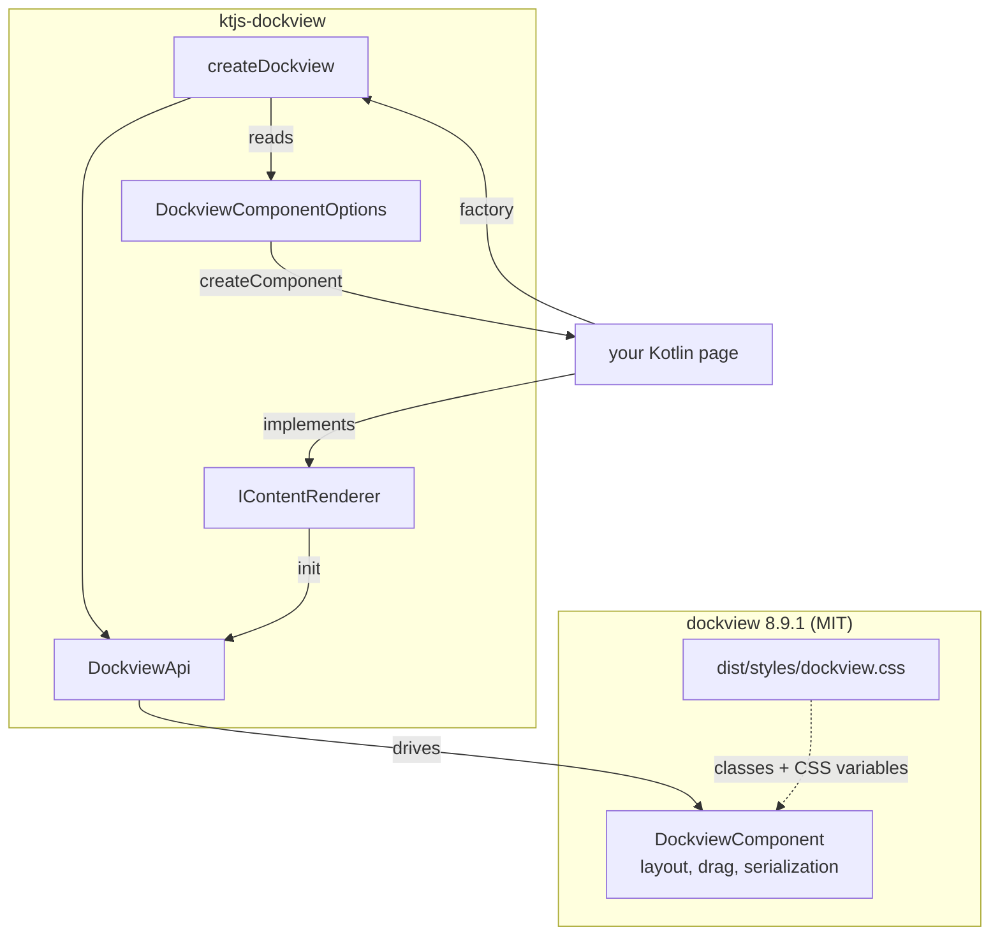
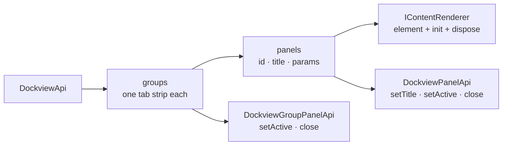

# ktjs-dockview

A Kotlin/JS wrapper for [`dockview`](https://github.com/dockview/dockview): the dock layout engine
with tabs, groups, split views and drag-and-drop — declared from upstream's own `.d.ts` files, with no
dynamic calls.

```kotlin
val api = createDockview(host, dockviewComponentOptions(::renderer) { theme = themeDark })

api.addPanel(addPanelOptions { id = "alpha"; component = "text"; title = "Alpha" })
api.addPanel(addPanelOptions { id = "bravo"; component = "text"; title = "Bravo" })

api.panels.size                              // 2
api.maximizeGroup(api.getPanel("alpha")!!)   // and the dock follows
```

The renderer is the only place a page has to write a real object: upstream asks for an
`IContentRenderer`, and this module declares the interface, so a Kotlin class can implement it.

```kotlin
class PanelRenderer(override val element: HTMLDivElement) : IContentRenderer {
    override fun init(parameters: GroupPanelPartInitParameters) {
        element.textContent = parameters.title
    }

    override fun dispose() = Unit
}
```

## What the module contains

| Kotlin entry point | Upstream | What it gives you |
| --- | --- | --- |
| `createDockview` | `createDockview(el, options)` | a `DockviewApi` over a sized host element |
| `DockviewApi` | `DockviewApi` | panels, groups, the active panel, layout in and out, theme updates |
| `DockviewComponentOptions` | `DockviewOptions & DockviewFrameworkOptions` | the option bag plus the required renderer factory |
| `DockviewOptions`, `dockviewOptions` | `DockviewOptions` | the fields this wrapper documents, every one nullable |
| `AddPanelOptions`, `addPanelOptions` | `AddPanelOptions` | what to add, where, under which title |
| `IContentRenderer`, `GroupPanelPartInitParameters` | the framework contract | the element, `init`, `dispose`, and the panel's own API |
| `DockviewTheme`, `themeDark` … | 18 exported theme objects | themes as values, not class-name strings |
| `DockviewEventSource`, `listen` | `Event<T>` | upstream's callable event, as a function type plus an extension |

The four factories — `createDockview`, `createSplitview`, `createGridview`, `createPaneview` — are all
declared; the dock is the one this module's tests and demo exercise, because it is the layout the
other three are cut from.

## How the pieces fit



A dock is a tree of three kinds of object, and every one of them has its own API:



`SerializedDockview` is an opaque interface on purpose: `toJSON()` returns a deeply nested shape that
changes with upstream minors, and the wrapper only passes it back to `fromJSON()`. Persist it on the
JavaScript side (`JSON.stringify`) if a string is what you need.

## What is deliberately not wrapped

`dockview` publishes several packages; only the framework-agnostic one is here.

| Upstream package | Licence | Why it is not in this module |
| --- | --- | --- |
| `dockview` (this module's target) | MIT | the vanilla layout engine |
| `dockview-react` / `-vue` / `-angular` | MIT | framework bindings; Kotlin/JS is neither of those frameworks |
| `dockview-enterprise` | **commercial** | proprietary licence, not redistributable here |
| the `modules` system (`registerModules`) | MIT | a plugin registry for extra features; not declared yet |

See [Licensing](guide/licensing.md) for the upstream texts and what a consumer has to do about them.

## Reading order

1. [Getting started](guide/getting-started.md) — the dependency, the stylesheet, the first dock.
2. [Usage](guide/usage.md) — panels, groups, events, layouts, themes, and the other three factories.
3. [Licensing](guide/licensing.md) — MIT here, MIT upstream, and the commercial package that stays out.

The [demo](https://shijianjs.github.io/ktjs-dockview/demo/) is a running consumer of this module, and
the [API reference](https://shijianjs.github.io/ktjs-dockview/api/) is the Dokka output for every
declaration this module publishes.
