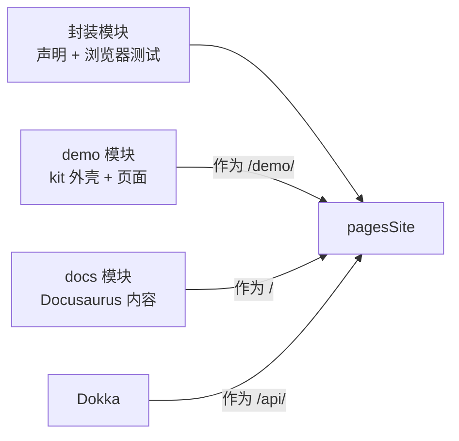

# 快速开始

## 环境要求

- JDK 21 或更新；Gradle wrapper 已入库（9.4.1）。
- Node 与 npm 由 Kotlin Gradle 插件下载并驱动——不需要记得跑 `npm install`，
  `kotlin.js.yarn=false` 让 npm 保持包管理器。
- 第一次跑浏览器测试时 Playwright 会下载 Chromium。

## 构建、测试、发布

```bash
./gradlew build                    # 编译、Detekt、浏览器测试
./gradlew :ktjs-dockview:jsBrowserTest
./gradlew :demo:e2eTest            # 用 Playwright 跑打包好的 demo 页面
./gradlew :docs:docusaurusBuild    # 文档站
./gradlew pagesSite                # 文档在 /、demo 在 /demo/、Dokka 在 /api/
```

`build` 不跑 demo 的端到端套件，也不组装 Pages 站点：两者都需要浏览器，CI 里是单独的步骤。



## 开发

```bash
./gradlew :docs:docusaurusStart              # 文档站的开发服务器
./gradlew :demo:jsBrowserDevelopmentRun      # demo 页面的开发服务器
```

Docusaurus 监视站点目录，改 Markdown 会重载；改 Kotlin 要先 `./gradlew :docs:docusaurusSite`，
因为站点导入的是编译后的模块。

### demo 开发服务器起不来时

`jsBrowserDevelopmentRun` 把 webpack 当外部进程跑。它非零退出时，Kotlin Gradle 插件只能报
`Error occurred. See log for details.`——webpack 的输出被当成进度行转发，任务结束时默认控制台又把
进度区擦掉了。换纯文本控制台重跑即可看到：

```bash
./gradlew :demo:jsBrowserDevelopmentRun --console=plain
```

纯文本控制台也是空的，就直接跑 Gradle 跑的那条命令、读它的 stderr；生成的包在
`build/js/packages/<module>-demo` 下：

```bash
cd build/js/packages/ktjs-dockview-demo
node ../../node_modules/webpack/bin/webpack.js serve --config webpack.config.js
```

任何可疑的启动失败，先换一个干净的 daemon：`./gradlew --stop` 再重跑。长活的 daemon 会带着上一轮
构建的残留状态。

## 依赖这个封装

```kotlin
kotlin {
    js {
        browser()
        binaries.library()
    }
    sourceSets {
        jsMain.dependencies {
            implementation("io.github.shijianjs:ktjs-dockview:8.9.1-kt.1")
        }
    }
}
```

发布版本号是 `{npm 版本}-kt.{修订号}`，所以 `8.9.1-kt.1` 是 `dockview` 8.9.1 加上第一个封装修订。
npm 包由模块自己声明，消费方不用再往 `package.json` 里加东西。

## 样式表不是可选项

`dockview` 的 CSS 单独发布在 `dockview/dist/styles/dockview.css`。页面不加载它，布局就没有边框、没有
标签页、没有拖拽手柄——而且控制台不会报任何错。

```html
<link rel="stylesheet" href="dockview.css">
```

```javascript
import "dockview/dist/styles/dockview.css"; // 能处理 CSS 导入的打包器
```

:::warning shadow root 内部
文档级样式表不会穿过 shadow 边界。如果你的页面把 dock 画在自己的 shadow 树里（本 demo 就是），
要把样式表的规则拷进一张 adopted stylesheet——demo 的 `DemoPage.addLinkedSheet("dockview.css")`
做的就是这件事，并把 `:root` 重新指向 `:host`，让主题的 CSS 变量仍然能解析。
:::

## 第一个 dock

宿主元素在建 dock 之前必须有高度：上游会量容器，高度为 0 时每个分组都是 0 尺寸。

```kotlin
val host = document.createElement(HtmlTagName.div).also { element ->
    element.style.width = "100%"
    element.style.height = "420px"
    document.body.append(element)
}

val api = createDockview(
    host,
    dockviewComponentOptions(createComponent = { options ->
        // 每个面板一个渲染器；`options.name` 是选项里注册的组件名。
        PanelRenderer(document.createElement(HtmlTagName.div))
    }) {
        theme = themeDark
    },
)

api.addPanel(addPanelOptions { id = "alpha"; component = "text"; title = "Alpha" })
```

`addPanelOptions` 里的 `component` 就是渲染器名：每个传同一个名字的面板都会从工厂拿到一个新对象。
工厂也是页面放自己状态的地方——demo 把每个渲染器收进一个列表，这样切换语言时能改写它们的文案。

## 目录结构

| 路径 | 内容 |
| --- | --- |
| `package.json` | npm 版本的唯一声明处（Dependabot 维护） |
| `wrapper-revisions.properties` | 每个模块的 `-kt.N` 修订号 |
| `ktjs-dockview/src/jsMain/kotlin` | 封装声明 |
| `ktjs-dockview/src/jsTest/kotlin` | 对应的浏览器测试 |
| `demo/src/jsMain` | demo 页面、各页与 Kotlin 入口 |
| `docs/src/jsMain/kotlin` | 站点配置与侧边栏 |
| `docs/src/jsMain/resources` | Markdown 页面、MDX 首页、CSS、翻译 |
| `docs/development/coverage.md` | 封了什么、排除了什么、为什么 |

## 锁文件

npm 依赖对整个 workspace 只解析一次，钉在 `kotlin-js-store/package-lock.json`。新增或升级 npm 依赖、
或改模块版本之后，要重新生成：

```bash
./gradlew kotlinUpgradePackageLock
```

CI 会校验入库的锁文件，忘了重新生成会在构建时失败，而不是悄悄漂移。
