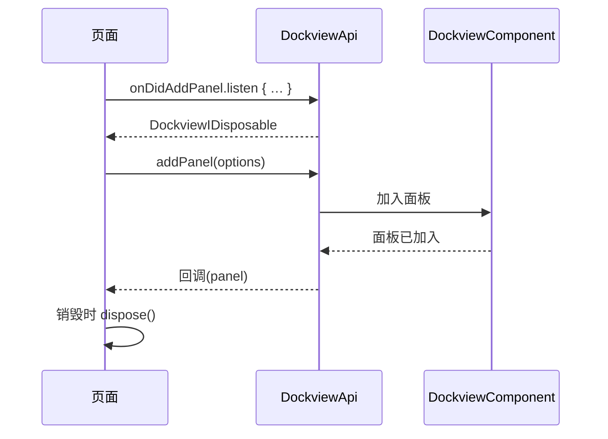
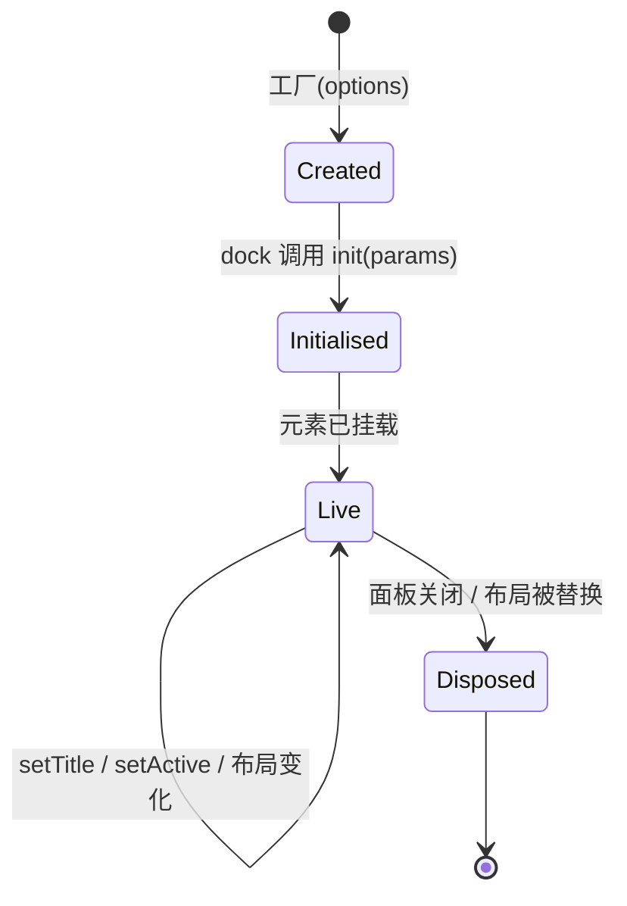
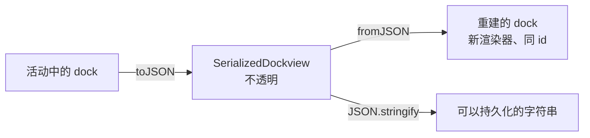

# 使用

## 面板

一个面板就是一条标签加它的内容。`addPanel` 返回面板对象，同一份选项对象在 `DockviewApi` 与
`DockviewComponent` 上都适用：

```kotlin
val panel = api.addPanel(
    addPanelOptions {
        id = "logs"            // 必填：之后每次查面板都用它
        component = "text"     // 必填：工厂注册过的渲染器名
        title = "Logs"         // 可选：标签显示的文字
        inactive = true        // 可选：加入但不抢激活
        initialWidth = 320.0   // 可选：第一次布局的尺寸提示
    },
)

api.getPanel("logs")   // 同一个对象；id 不存在时是 null
api.totalPanels        // 所有分组的面板总数
```

`params` 与 `position` 都是 `JsAny`：上游对它们各自接受好几种形状（普通对象、对另一个面板的引用、
一个方向），封装层不为它们造 Kotlin 联合类型。在边界处用 `unsafeJso` 构造。

关掉面板有两种方式：`api.removePanel(panel)` 把它从布局里移除，`panel.close()` 走面板自己的 API
（同样会触发事件）。

## 分组

分组就是一条标签栏。不带位置加进去的面板落在活动分组；要分栏就先加分组建：

```kotlin
val side = api.addGroup(
    addGroupOptions {
        direction = "right"
        referencePanel = js("{ panelId: 'logs' }")
    },
)

api.groups
api.activeGroup
api.maximizeGroup(panel)   // 用一个分组占满 dock
api.exitMaximizedGroup()
api.closeAllGroups()
```

上游允许 `addGroup(null)`，意思是「在活动分组上加一个」；Kotlin 签名保留可空参数正是为了这一种情况。

## 事件

上游的事件是可调用对象（`event(listener)` 返回一个 disposer）。在 Kotlin 里它是函数类型，订阅就是一个
扩展函数：

```kotlin
val subscription = api.onDidAddPanel.listen { panel ->
    status.set("added ${panel.id}")
}

subscription.dispose()   // 退订
```

| 事件 | 载荷 |
| --- | --- |
| `onDidLayoutChange` | `LayoutChangeEvent`（触发原因，一个 `ReadonlySet`） |
| `onDidLayoutFromJSON` | 恢复出来的布局 |
| `onDidAddPanel` / `onDidRemovePanel` | `DockviewPanel` |
| `onDidActivePanelChange` | 新激活的 `DockviewPanel` |
| `onDidAddGroup` / `onDidRemoveGroup` | `DockviewGroupPanel` |
| `onDidMovePanel` | 被移动的面板 |
| `panel.api.onDidTitleChange` | `TitleEvent` |
| `panel.api.onDidActiveChange` | 激活状态 |



## 渲染器

工厂每个面板被调一次，参数是 `{ id, name }`；它返回的对象就是该面板的内容，活到面板结束。

```kotlin
class PanelRenderer(override val element: HTMLDivElement) : IContentRenderer {
    override fun init(parameters: GroupPanelPartInitParameters) {
        element.textContent = parameters.title
        element.dataset["panel"] = parameters.api.id
        // parameters.containerApi 是整个 dock，用于跨面板协作
    }

    override fun dispose() = Unit
}
```



元素属于渲染器，不属于 dock：上游挂载你返回的元素，放手时调用 `dispose()`。不要把这个元素挪到别处。

## 布局的导出与恢复

`toJSON()` 返回一个 `SerializedDockview`，故意不透明。放在内存里（或在 JS 侧 `JSON.stringify`）
再交回去就行：

```kotlin
var saved: SerializedDockview? = null

saveButton.onClick { saved = api.toJSON() }
restoreButton.onClick { saved?.let { api.fromJSON(it) } }
```



`fromJSON` 按序列化树重建布局：它会对每个面板重新调用渲染器工厂，所以自己维护渲染器列表的页面
在恢复前要清空那个列表。

## 主题

主题是导出的值，写错就是编译错误，而不是一个不起作用的类名：

```kotlin
api.updateOptions(dockviewOptions { theme = themeLight })
```

一共导出 18 个：`themeDark`、`themeLight`、`themeVisualStudio`、`themeAbyss`、`themeDracula`、
`themeNord`、`themeCatppuccinMocha`、`themeMonokai`、`themeSolarizedLight`、`themeGithubDark`、
`themeGithubLight`，以及其中带 `*Spaced` 变体的那些。每个都带 `name`、`className` 与 `colorScheme`。

## 选项

`dockviewOptions { }` 只写 lambda 里设过的字段，其余全部保留上游默认值。封装层声明了上游约 60 个字段
中的 23 个：文档覆盖的那些。联合类型的（`dndEdges`、`overflow`、`dndCompass`、`floatingGroupBounds`）
保持 `JsAny`；其余是可空的基本类型。

## 另外三个工厂

| 工厂 | 返回 | 渲染器类型 | 用途 |
| --- | --- | --- | --- |
| `createSplitview` | `SplitviewApi` | `SplitviewPanel` | 一维分栏，没有标签页 |
| `createGridview` | `GridviewApi` | `GridviewPanel` | 面板网格，不能停靠 |
| `createPaneview` | `PaneviewApi` | `IPanePart` | 手风琴式窗格 |

它们的选项集合与加面板选项沿用同一套构造器（`splitviewComponentOptions`、`gridviewComponentOptions`、
`paneviewComponentOptions`）。`GridviewOptions.orientation` 上游必填，所以构造器把它作为位置参数。

## 封装层不做的事

- 不做布局计算、不做拖拽实现、不定序列化格式：这些是 dock 的事。
- 不带 CSS：样式表是上游的，由页面引入。
- 不重新声明 `SerializedDockview` 的内部结构；它按设计就是不透明的。
