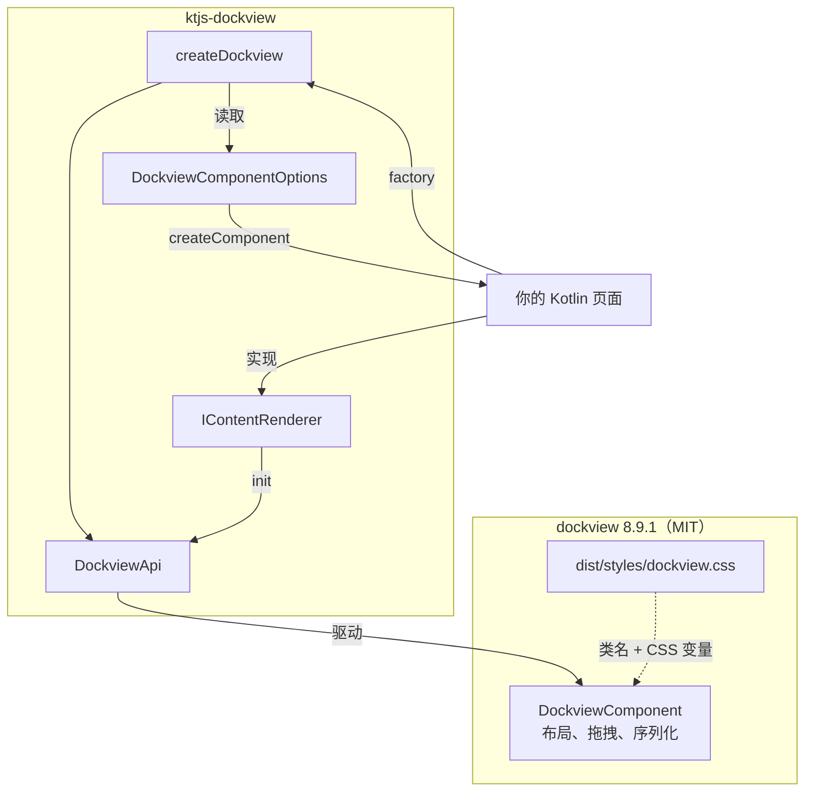
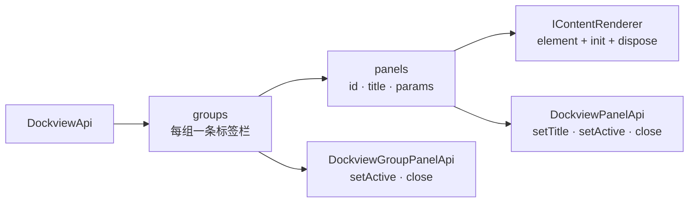

# ktjs-dockview

围绕 [`dockview`](https://github.com/dockview/dockview) 的 Kotlin/JS 封装：带标签页、分组、分栏与拖拽的
停靠布局引擎——按上游自带的 `.d.ts` 声明，不写 dynamic 调用。

```kotlin
val api = createDockview(host, dockviewComponentOptions(::renderer) { theme = themeDark })

api.addPanel(addPanelOptions { id = "alpha"; component = "text"; title = "Alpha" })
api.addPanel(addPanelOptions { id = "bravo"; component = "text"; title = "Bravo" })

api.panels.size                              // 2
api.maximizeGroup(api.getPanel("alpha")!!)   // 布局随之变化
```

页面唯一必须自己写的对象是渲染器：上游要一个 `IContentRenderer`，本模块把这个接口声明出来，
所以 Kotlin 类可以直接实现它。

```kotlin
class PanelRenderer(override val element: HTMLDivElement) : IContentRenderer {
    override fun init(parameters: GroupPanelPartInitParameters) {
        element.textContent = parameters.title
    }

    override fun dispose() = Unit
}
```

## 模块里有什么

| Kotlin 入口 | 上游 | 提供什么 |
| --- | --- | --- |
| `createDockview` | `createDockview(el, options)` | 在一个有尺寸的宿主元素上返回 `DockviewApi` |
| `DockviewApi` | `DockviewApi` | 面板、分组、活动面板、布局导入导出、主题更新 |
| `DockviewComponentOptions` | `DockviewOptions & DockviewFrameworkOptions` | 选项集合加上必填的渲染器工厂 |
| `DockviewOptions`、`dockviewOptions` | `DockviewOptions` | 本封装覆盖的字段，全部可空 |
| `AddPanelOptions`、`addPanelOptions` | `AddPanelOptions` | 加什么、加在哪、标题是什么 |
| `IContentRenderer`、`GroupPanelPartInitParameters` | 框架契约 | 元素、`init`、`dispose`，以及面板自己的 API |
| `DockviewTheme`、`themeDark` 等 | 18 个导出的主题对象 | 主题是值，不是类名字符串 |
| `DockviewEventSource`、`listen` | `Event<T>` | 上游的可调用事件，映射成函数类型加扩展 |

四个工厂——`createDockview`、`createSplitview`、`createGridview`、`createPaneview`——都已声明；测试与
demo 演练的是 dock，因为另外三个布局是由它派生出来的。

## 各部分怎么咬合



一个 dock 是三类对象组成的树，每一类都有自己的 API：



`SerializedDockview` 故意是不透明接口：`toJSON()` 返回的结构很深、会随上游小版本变化，封装层只把它
原样交回 `fromJSON()`。需要持久化就在 JS 侧 `JSON.stringify`。

## 哪些部分故意不封装

`dockview` 发布了好几个包，这里只做与框架无关的那一个。

| 上游包 | 许可 | 不放进本模块的理由 |
| --- | --- | --- |
| `dockview`（本模块的目标） | MIT | 原生布局引擎 |
| `dockview-react` / `-vue` / `-angular` | MIT | 框架绑定；Kotlin/JS 不是这些框架 |
| `dockview-enterprise` | **商业许可** | 专有许可，不能在这里再分发 |
| `modules` 系统（`registerModules`） | MIT | 额外功能的插件注册表，暂未声明 |

许可细节与消费方要做的事见[许可](guide/licensing.md)。

## 阅读顺序

1. [快速开始](guide/getting-started.md)——依赖、样式表、第一个 dock。
2. [使用](guide/usage.md)——面板、分组、事件、布局、主题，以及另外三个工厂。
3. [许可](guide/licensing.md)——本模块 MIT、上游 MIT，以及必须排除的商业包。

[demo](https://shijianjs.github.io/ktjs-dockview/demo/) 是这个模块的真实使用方，
[API 文档](https://shijianjs.github.io/ktjs-dockview/api/) 是本模块每个声明的 Dokka 输出。
